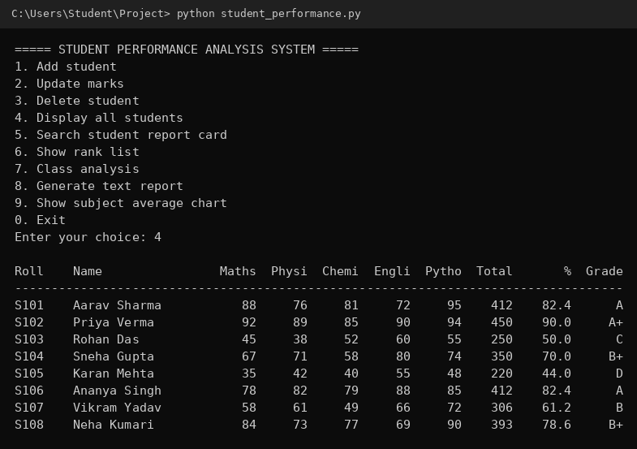
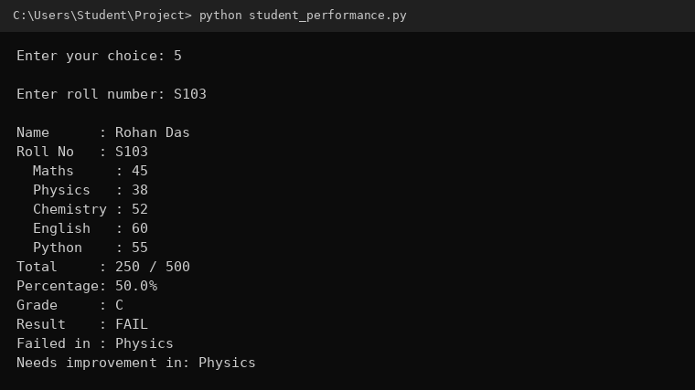
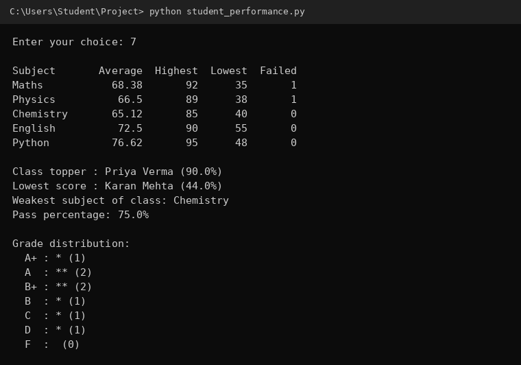
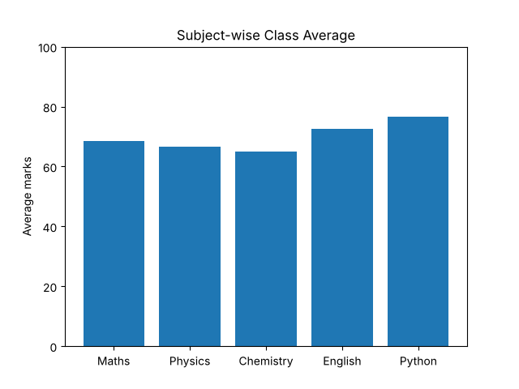

# Student Performance Analysis System

Menu-driven Python app to manage student marks and analyse class performance.
Built for **Computational Thinking and Programming (2026CSAE100)**, Bennett University.

## Features
- Add, update, delete and search student records (stored in CSV)
- Percentage, grade (A+ to F) and pass/fail calculation
- Rank list with tie handling
- Subject-wise average, highest, lowest and fail count
- Weak-subject detection for each student
- Auto-generated text report and subject-average bar chart (matplotlib)
- Input checks for wrong or unexpected input

## How to Run
```bash
pip install matplotlib
python student_performance.py
```
Keep `students.csv` in the same folder.

## Screenshots
**Main Menu**


**Student Report Card**


**Class Analysis**


**Subject-wise Class Average**


All outputs are in the [Screenshots](Screenshots/) folder.

## Project Files
| File | Description |
|------|-------------|
| `student_performance.py` | Complete source code |
| `students.csv` | Sample data (8 students) |
| `class_report_20261028_1814.txt` | Generated class report |
| `subject_average.png` | Generated chart |
| `Screenshots/` | Program outputs |
| Project Report (PDF), Presentation (PPTX) | Documentation |

## Team
| Member | Role |
|--------|------|
| Ayush Sharma | Core logic, CSV file handling |
| Ishaan Mani Tripathi | Calculations and grading engine |
| Shreyansh Gupta Batchu | Menu and input handling |
| Atharv Gupta | Analysis, reports and charts |
| Munna Kumar | Algorithm design, testing, weak-subject logic, report and slides |
